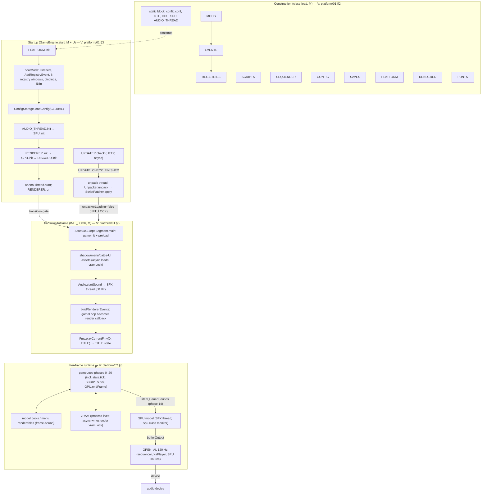

# Cross-System Architecture Review

Status: Complete (M10, 2026-11-13). Synthesis of M1–M9; the primary inputs are the milestone documents listed in §1.1, cross-checked against `GameEngine`, `Scus94491BpeSegment`, `EngineStates`, `Registries`, and the unpacker as documented by those documents. No new unsourced claims: every structural statement carries a milestone-document citation. Bounded direct verifications performed during M10 for the register re-triage (lwjglx jar manifest, Mod-Loader 4.2.5→4.3.5 git diff, JavaFX import graph, frame-skip commit history) are enumerated in §9. Provenance: findings originally verified against the primary reference at `0c08c679b` (M1–M9-06) keep that provenance; M9-07 and the M10 spot-checks were verified against `71ce130364ed00431d420891370d5314a4e3d4c4` (the Phase-A delta census, `game/07` §12.1, is L4-UI-only and invalidated no prior finding). All four reference repositories were verified unchanged at M10 preflight and exit. This document applies the AGENTS.md "PSX Address and Offset Documentation Conventions" to its annotations (eight-digit lowercase addresses, zero-padded lowercase offsets); `0x...` values survive only where the exceptions clause applies (typed bit masks, byte offsets in cited layouts).

## 1. Scope and method

M10 closes the research loop: it assembles the verified findings of R0/R1, M2–M9 into (a) a single cited dependency/initialization graph, (b) a runtime-service map, (c) a shared-state and ownership inventory, (d) a reconciled concurrency model, and (e) end-to-end cross-system data and event flows. It refines the two R1 foundational architecture passes (`research/architecture/01–03`) that were explicitly scoped as "M10 refines" by the plan's Phase Alignment section.

### 1.1 Milestone coverage map (one document per milestone)

| Milestone | Documents | Contribution to this review |
|---|---|---|
| R0/R1 (platform, lifecycle, execution model; foundational architecture passes) | `platform/01-application-lifecycle.md`, `platform/02-execution-model.md`, `platform/04-engine-states.md`, `platform/05-input-and-platform.md`, `architecture/01-runtime-subsystems.md`, `architecture/02-subsystem-interactions.md`, `architecture/03-state-and-ownership.md`, `psx/01-compatibility-boundaries.md` | Boot chain, frame loop, thread model, engine-state machine, service inventory, interaction matrices, ownership map, layer classification |
| M2 (assets) | `assets/01–10` | Startup unpack pipeline, format contracts, `files/` cache, runtime load contract (null-on-failure, `scriptWaitForFilesToLoad`) |
| M3 (Fate scripting) | `scripting/01–06` | Script VM contract, binary format, 592-slot native catalog, round-trip/patch semantics, meta system |
| M4 (PSX hardware) | `psx/01-gpu-vram-ordering.md`, `psx/02-gte.md`, `psx/03-spu.md`, `psx/04-xa-adpcm.md`, `psx/05-compatibility-classification.md` | GPU/GTE/SPU/XA models, fixed-point/RNG helpers, the 43-row compatibility master table |
| M5 (rendering) | `rendering/01–04` | Frame render structure, TMD pipeline, UI/text, post-processing/FMV presentation |
| M6 (audio) | `audio/01–03` | Three-pipeline/two-SSSQ-player architecture, clock domains, SSSQ/SSHD/XA contracts |
| M7 (persistence) | `saves/01-save-formats.md`, `saves/02-config.md` | 11 save versions, Tag model, campaign/memcard model, load ordering, config system |
| M8 (modding) | `modding/01–03` | Mod lifecycle, 21 registries, event contract, core-mod census, script-patch and i18n surfaces |
| M9 (game systems) | `game/01–07` (incl. 05a/05b/05c) | Per-system behavioral contracts; the RQ7 script-vs-hardcode spectrum; per-system state surfaces and RNG censuses |
| Audits | `audits/r0-r1-xhigh-audit.md` (F-01…F-18), `audits/m3-xhigh-audit.md` | Corrections that the synthesis below already carries |

### 1.2 Method and evidence rules

- Every edge in every graph is classified **V** (verified at the cited source) or **I** (inferred; the inference is named).
- The reference is authoritative for observed behavior. Where the reference diverges from the decompiled retail contract, both are stated (the M9 per-system retail/reference tables are the authority).
- No `asset-validated` claims exist anywhere in M1–M10 (no disc images or proprietary assets were available at any point — register R-01).
- "Original (retail)" = decompiled `@Method`-anchored contract or format documented from retail data consumers; "reference (layer 4)" = Severed-Chains implementation choice; "proposed" = future design, out of scope here.

## 2. Initialization and shutdown

### 2.1 The boot chain (process start → ROM init → title)

Thread key: **M** = process main thread ("Hardware"), **U** = unpack thread, **A** = Async pool, **O** = OPEN_AL audio thread, **S** = SFX audio thread. Numbered in verified order; citations in the right column.

| # | Step (thread) | Behavior | Citation |
|---|---|---|---|
| 1 | Updater swap (M) | A staged `updater.jar.new` is atomically moved over `updater.jar`; failure non-fatal | `platform/01` §1 |
| 2 | Service construction (M, class-load time) | `GameEngine` static fields in fixed order: MODS → LANG → EVENTS → REGISTRIES → SCRIPTS → SEQUENCER → CONFIG → SAVES → PLATFORM → RENDERER → FONTS → static block (config.conf load-or-create; GTE, GPU, SPU, AUDIO_THREAD; current thread named "Hardware"; OPEN_AL thread created, not started). Constructor-time dependency: REGISTRIES needs EVENTS; everything else is construction-standalone | `platform/01` §2; `architecture/01` §3 |
| 3 | Update check (M → HTTP) | `UPDATER.check` async GET (10 s timeout); result under `UPDATER_LOCK`; never blocks startup | `platform/01` §3.1 |
| 4 | Unpack thread start (U) | Sets the render callback to the loading screen **before** `RENDERER.init` (safe: read only at onDraw time); `Unpacker.unpack` (four-disc wait gate with per-disc prompts; `files/` cache, VERSION=5; per-node incremental skip); `ScriptPatcher.apply` (353 entries; CRC32-gated); waits `UPDATE_CHECK_FINISHED`; then `unpackerLoading = false` under `INIT_LOCK` | `platform/01` §3.3; `assets/03`; `modding/03` §3 |
| 5 | Platform + mods (M) | `PLATFORM.init` (SDL3, gamepads); `findMods("./mods")`; `bootMods(all)` — the 12-step re-entrant boot (framework reset, load, listener discovery, `AddRegistryEvent`, the 8 title-needed registry windows, input bindings, i18n, failure toasts) | `platform/01` §3.4–3.7, §4; `modding/01` |
| 6 | Global config (M) | `ConfigStorage.loadConfig(GLOBAL, "config.dcnf")` — **after** bootMods, because entries must be registered first | `platform/01` §3.8; `saves/02` |
| 7 | Audio (M) | `AUDIO_THREAD.init` (device + context; core sequencer + XaPlayer sources; 2 s device-poll scheduler) → `SPU.init` (SPU's `GenericSource` registered) | `platform/01` §3.10–3.11; `audio/01` |
| 8 | Renderer + GPU (M) | `RENDERER.init` (window; 6 shader families; onDraw handler) → close handler → `GPU.init` (VRAM textures, display mesh, 320×240) → `DISCORD.init` | `platform/01` §3.12–3.15; `rendering/01` |
| 9 | Render loop (M) | `openalThread.start` (120 Hz) → `RENDERER.run()`; loading screen frames (intro.mp4 → `renderIntro`); the SFX thread does **not** exist yet — intro silence is by design | `platform/01` §3.16–3.17; `architecture/02` §2 |
| 10 | Transition gate (M) | `cinematicFinished && !unpackerLoading && UPDATE_CHECK_FINISHED → transitionToGame()` under `INIT_LOCK` | `platform/01` §5 |
| 11 | ROM entry (M) | `Scus94491BpeSegment.main()` (`@Method(0x800e5d44)`) = `gameInit()` + `preload()` (§2.2); shadow model parts marked persistent; `loadMenuAssets`; textbox geometry; `battleUiParts.init` | `platform/01` §5.2–5.3 |
| 12 | SFX thread (M → S) | `Audio.startSound()` starts the 60 Hz SFX loop (game sequencer facade + SPU model) | `platform/01` §5.4; `platform/02` §6 |
| 13 | Frame callback swap (M) | `bindRendererEvents()`: input actions → engine state; **`gameLoop` becomes the render callback**; window close → `stopSound` + `AUDIO_THREAD.stop` + JavaFX `Platform.exit` | `platform/01` §5.5 |
| 14 | FMV 0 → TITLE (M) | `Fmv.playCurrentFmv(0, TITLE)`: the opening MDEC (`STR/DEMOH.IKI`) as a render-callback takeover that queues TITLE (it is not an engine state); 15 fps / 2× CD cadence, in-band 37800 Hz XA | `game/02` T8; `rendering/04` §4 |

**Verified** for the ordering (every step is a cited call site; `architecture/02` §2 documents the two cross-thread handshakes — `INIT_LOCK` unpack↔transition, `UPDATER_LOCK` HTTP↔main — and the deliberate pattern that *everything the first rendered frame might touch is initialized before `RENDERER.run()`*, with the SFX thread as the only post-run initialization).

### 2.2 ROM initialization (`gameInit` / `preload`)

`gameInit()` (`@Method(0x800e5d64)`, in order): `ResetGraph` → ordering-table configuration (bits 14, zShift 0, size 0x4000, zMax 0x3ffe) → draw offsets + clear color 0 → `InitGeom` + projection plane 640 → `initSound` → `vsyncMode = 2` (30 Hz base) + `tickCount = 0` → `loadSystemFont` (font.tim → VRAM (832, 424) + 32-entry CLUT) → `SCRIPTS.clear()` → `loadShadow` → `clearRenderables` → `initFmvs`. `preload()` (`@Method(0x800e6184)`): `drgnBinIndex = 1` → menu sounds → `resizeDisplay(320, 240)` → `vsyncMode = 2` → `loadBasicUiTexturesAndSomethingElse` (async DRGN0/6669 MRG load; the completion callback uploads to VRAM **from the Async pool under the GPU's `vramLock`** — the canonical async→VRAM hand; textZ = 13; textbox init). Citation: `platform/01` §5 "ROM initialization"; `psx/01` (ordering constants, M4-01).

### 2.3 The engine state machine

Single-instance, queued-transition state machine (registry-extended; 7 retail states: `title`, `credits`, `submap`, `world_map`, `battle`, `final_fmv`, `game_over`). Transition contract (`platform/04` §2–§3):

- Any caller sets `engineStateOnceLoaded` (8004dd24 - queued target type) + optional `engineStateData` (Tag save data).
- At the **top of the next frame**, `loadQueuedOverlay` (`@Method(0x800128c4)`): menu-stack reset → record `previousEngineState` (8004dd28 - state being left) → force `vsyncMode = 2` → `loadGameStateOverlay` (`@Method(0x80012a84)`) → clear queue → post `EngineStateChangeEvent` → rich presence.
- `loadGameStateOverlay`: `SCRIPTS.setFramesPerTick(1)` → **self-transition no-op** → mark non-persistent `Obj`/`Texture` for deletion → `current.destroy()` → construct + `init()` → optional `readSaveData` → **install the per-state script-native function table** → set render mode + projections.
- Consequences: the frame on which the queue is set still runs the old state to completion (including its script tick); no transition is mid-frame; the old state is destroyed before the new one inits; scene teardown is coalesced to the **end-of-frame fixed point of the same onDraw** (after that frame's render pass — audit F-03).
- Render mode per state: only SUBMAP and TITLE use `LEGACY` (the PSX-style H-division pseudo-perspective); all others use `PERSPECTIVE`. Dabas/FMV/VideoPlayer save-restore the render mode around their content without changing engine state (`platform/04` §8; `game/01` §5; `game/02`; `rendering/04`).

Support globals (`platform/04` §3; `architecture/03` §1):

| Address | Field | Purpose |
|---|---|---|
| 8004dd04 | `currentEngineState` | the single live state instance |
| 8004dd24 | `engineStateOnceLoaded` | queued target type |
| 8004dd28 | `previousEngineState` | state being left (set at apply time) |
| 800bc91c | `postBattleEngineState` | where the current battle returns |
| — | `lastSavableEngineState` | last savable state (crash recovery; set only in `WMap.init`/`SMap.init` — `saves/01` §10) |
| — | `postCreditsEngineState` | state after credits (mod-facing) |

### 2.4 The retail state transition graph

Edges are the verified call sites (`platform/04` §3) plus the M9-verified system edges:

```
            ┌───────────────────────────────────────────────────────────────┐
            │ (loading) → [FMV 0] → TITLE                                   │
            └──────────────┬────────────────────────────────────────────────┘
                           │ new game (resetSubmapToNewGame + bootMods)      │ load save
                           ▼                                                 ▼ (Ttle:650 —
                        SUBMAP ◀────────────────────────────────────── the save's recorded
        │  │  │  │  │              │  │  │                                   engine state)
        │  │  │  │  │              │  │  └→ TITLE (quit)                     │
        │  │  │  │  │              │  └→ WORLD_MAP (map exits; the           │
        │  │  │  │  │              │     submapCut/collidedPrimitiveIndex    │
        │  │  │  │  │              │     hand-off pair is the sole payload)  │
        │  │  │  │  │              └→ BATTLE (scene 6; submapCutBeforeBattle)│
        │  │  │  │  └→ SHOP / INVENTORY / chapter save (menu overlays —      │
        │  │  │  │     not engine states)                                    │
        │  │  │  └→ TOO_MANY_ITEMS (post-battle hand-off)                    │
        │  │  └→ char-swap / FMV (mapTransition dispatch, special scenes)    │
        │  └→ GAME_OVER (defeat) ──(menu)──▶ TITLE (and resetSubmapToNewGame │
        │        at stage 0: a defeat always returns to the opening submap)  │
        └→ DABAS (temporary render-mode takeover; reward hand-off)           │
                                                                             │
                        BATTLE ──(end: postBattleAction registry)───────────┘
                        WORLD_MAP ──(map exits)──▶ SUBMAP / queued target
                        CREDITS ◀──(AboutScreen, any state)
```

M9 edge details: battle entry has four paths (submap scene 6, world-map flag-0x100 location, game var 43 int/RegistryId dual mode, debugger) over the `SBtld` dissolve transition (`game/05a` §2); battle end queues `postBattleEngineState` via the post-battle action registry (`game/05c`); submap `mapTransition` dispatch (submap/world map/battle/FMV/title/game over/char-swap/too-many-items/chapter save/shop/inventory, special scenes 0x3fa–0x3ff — `game/03` §5); world-map special travel (Coolon warp, Wingly teleport, Queen Fury, the Barrier Stations as pseudo-cut-999 wmap-internal transitions — `game/04` §7). **Verified** (all call sites cited in the cited documents).

### 2.5 Registry boot windows and campaign-scoped reboots

- **`bootMods`** is re-entrant and campaign-scoped, not just a startup phase. Twelve call sites (`modding/01`): startup; the retail `main` (`@Method(0x800e5d44)`); new game (`resetSubmapToNewGame`); title (`Ttle:570`); save management (empty mod set); campaign selection (per-campaign `ENABLED_MODS_CONFIG` set, falling back to all mods); the memcard-flow required-only boot with `finally` restore; the installed-mods-changed and missing-mods consent flows; the new-campaign preset/mods-editing reboots. Each boot: full framework reset → load → listener discovery → `AddRegistryEvent` → the **8 explicit registry windows** (config, campaignTypes, engineStateTypes, inputActions, characterTemplates, statTypes, statModTypes, goods — the last justified by a source comment for title-screen save cards) → input bindings → i18n.
- **`bootRegistries`** opens the **13 remaining registry windows** via `initializeRemaining` (3 call sites: memcard conversion, full save load, new campaign — `modding/02`).
- Reset semantics: per-boot entry re-creation; the **stale-entry hazard** for non-delegate caching; delegates (pre-registration-valid, `Latch`-cached) are the safe pattern (`modding/02`).
- Consequence: a campaign can run under a different mod set than the one that booted the process; saves record `enabled_mods`/`known_mods` per campaign (`modding/01`; `saves/02`).

### 2.6 Shutdown and teardown

Normal shutdown (window close), verified order (`platform/01` §7): close callbacks in registration order (game handler: `stopSound` → SFX thread stops; `AUDIO_THREAD.stop` → OpenAL destroyed; JavaFX `Platform.exit` — no-op unless the debugger started) → `Async::shutdown` → `PLATFORM::stop` → loop exits → `RenderEngine.run` finally: `Config.save` (config.conf) → `GameEngine.start` finally: `DISCORD.destroy` → `AUDIO_THREAD.destroy` → `RENDERER.delete` (all shaders/objs/textures) → `UPDATER.delete` → `PLATFORM.destroy`. The "JVM exits" final step is `Inferred` (no explicit exit call on the clean path).

Failure/recovery: any `Throwable` → `Main.main` catch → if `gameState != null` and the `create_crash_save` config (default true): load all saves (async), unique name, restore submap position from the live collision globals (collidedPrimitiveIndex → submapScene; submapCut → cut_a8 — mirroring SMap's own save path), restore `lastSavableEngineState` (fresh instance), write a "Crash Recovery N" save → crash log + mod census + `CRASHLOG-<ts>.log` copy → `System.exit(1)`. Other failure classes (unpack failure = stuck loading screen; audio device loss = park + retry loop; GL context = GLES fallback → crash; mod failure = recorded + title toast; critical event handler = rethrown `EventHandlerException` into the crash path) are tabulated in `platform/01` §7 and `modding/02` (D15/D16).

### 2.7 The dependency/initialization graph

Mermaid diagram; edge labels cite the section above (V = verified ordering, I = inferred).



Every edge is **V** except the `OAL → HW` leaf (the device layer is `Inferred` as a plain audio sink; `audio/01` documents the hosting). No edge in the diagram contradicts an M1–M9 finding; the diagram is a projection of the cited sequences, not new evidence.

### 2.8 Constructor-time vs initialization-time dependencies

| Phase | What must hold | Citation |
|---|---|---|
| Construction (class-load) | Field order: REGISTRIES after EVENTS (it needs it); AUDIO_THREAD before SPU (SPU.init registers a source on it); the "Hardware" thread is whichever thread first triggers class init (in practice main) | `platform/01` §2 |
| Init (before first frame) | PLATFORM before RENDERER (window); RENDERER before GPU (shader manager + resize hook); AUDIO_THREAD before SPU; config entries registered (bootMods) before `loadConfig` | `platform/01` §3; `architecture/01` §3 |
| Transition (first game frame) | `files/` present (unpack complete, `INIT_LOCK`); GPU initialized (ordering table, VRAM); SCRIPTS present; the loadGfx render callback already registered pre-init (cross-thread registration, safe because read only at onDraw time) | `platform/01` §3.3, §5 |
| First frame of a state | Per-state script-native table installed **at transition apply**, not at first tick; `vsyncMode` forced to 2 then possibly re-assigned by the entering state's first tick **in the same frame** (pacing phase 3 runs before transition phase 4 and state tick phase 6) | `platform/04` §3; `platform/02` §5 |
| Campaign scope | bootMods + bootRegistries + ConfigPresetState refresh before any campaign data is read; save-load ordering: config → registry boot → `createGameState` → state data → `modData` event → campaign hook → `GameLoadedEvent` → `whichMenu` UNLOAD | `modding/01`; `saves/01` |

## 3. Runtime services

How the engine states depend on each runtime service. Frame-phase numbers are the `gameLoop` phases (`platform/02` §3); "states" lists the states with material dependence.

| Service | Owner thread | Frame touchpoints | Dependent states | Key contract | Citation |
|---|---|---|---|---|---|
| Rendering (`RenderEngine` + pools) | main (onDraw) | render tick: task flush → resize → `pre` → stale-ref purge → `renderFrame` (gameLoop inside) → main pass (sort → 3D/2D opaque/translucent → translucency passes) → post pass → bookkeeping | all (per-state render mode; Dabas/FMV/VideoPlayer save-restore) | frame-bound pools; `ignoreQueues` on turbo-skip frames; `legacyMode` 0/1/2 | `rendering/01`; `platform/02` §2 |
| GPU model (VRAM, z-queues) | main (frame tick) + async VRAM writes | phase 1 (`GPU.startFrame`: dirty VRAM → texture), phase 19 (`GPU.endFrame`: z-queue render + display flip) | all (title menus, submap, battle, FMV letterbox) | 1024×512 VRAM; ordering table (0x4000/zMax 0x3ffe); `vramLock` on every VRAM write | `psx/01` (M4-01); `psx/05` G1–G15 |
| GTE model | main | inside TMD/battle/submap camera code paths (phase 6/10 territory) | submap (integer-precision camera), battle, TMD animation | float model with documented bounded divergence; the submap camera must stay integer (`GsSetSmapRefView2L`) | `psx/02`; M4-05 T1–T7 |
| Audio: music (core SSSQ sequencer) | OPEN_AL (tick); main (control) | none (real-time 120 Hz loop; tight while the sequencer can buffer) | all (per-state BGM; per-cut submap music 8×8 table; battle music tables; FMV XA) | BGM = sample-accurate BPM; `sssqResetStuff` at state init; no ducking machinery beyond fades | `audio/01`; `audio/02`; `game/03` §6; `game/05a` §9 |
| Audio: SFX (SPU model + game sequencer facade) | SFX (60 Hz tick); main (control) | phase 14 (`startQueuedSounds` → key-on words) | all (menu sounds, battle SFX slots, Dabas DAC) | edge-word protocol (accumulate/snapshot/zero); dynamic voice allocation (matching retrigger → bound-gated steal → round-robin → finished fallback) | `audio/01` §9; `psx/03`; M4-05 S1–S9 |
| Audio: XA/Opus (`XaPlayer`) | OPEN_AL (10 ms ticks) | none | music (`scriptLoadXa` → `XA/LODXA0%d.XA/%d.opus`), FMV audio (main-thread 15 fps demux with native-rate `XaAdpcm` decode — a fourth, main-thread-consuming path), mod video | 37800→48000 Catmull-Rom 80/63 transcode at unpack; pre-skip 312; drop-on-full backpressure | `audio/03`; `rendering/04` §4 |
| Fate script runtime (`ScriptManager`/`ScriptState`) | main | phase 10 (`SCRIPTS.tick`; `framesPerTick` cadence, 1 in normal play, 2 in submap exploration), phase 11 (`postScriptTick`), phase 4 (transition: `setFramesPerTick(1)` + native-table reinstall) | all (submap: 144 native functions + controller scripts; battle: the 362-slot contract; the rest: flag/var surface) | 108 slots (0–8 reserved; round-robin allocation); native call → 1024-entry table (global-first, then per-state); stor[63]/var/flag(16–27) surface | `scripting/05`; `scripting/06`; `game/03` §3; `game/05a` §7; M4-05 §2.5 |
| Input | main (input tick, before render tick) | input tick: SDL pump → action edges → `inputActionPressed/Released` → repeat → rumble lerp; one-frame `pressed` cleared after onDraw | all | two-tier model (semantic actions over physical activations); per-state action sets; `scriptInputActionPressed/Held` natives | `platform/05`; `platform/02` §4 |
| Resource loading (`Loader`/`DrgnFiles`/Async pool) | Async pool (loads); main (consumers) | inside any phase (async); the ROM's script-side wait: `scriptWaitForFilesToLoad` (`@Method(0x80017564)`) returns `PAUSE_AND_REWIND` while loads are pending | all (per-cut DRGN directories, battle TMDs at DRGN0/2497+stage, DEFFs, music packages, portraits) | failure → completed-with-`null` (absent asset, never torn); files/ cache VERSION=5; CRC-mirror patch cache | `assets/01` §6; Q-43 (closed) |
| Saves/Config (`SaveManager`, `ConfigCollection`) | main | none per-frame (menu-driven + crash path); `ConfigLoadedEvent` + frame-skip re-apply after location loads | all (state Tags at WMap/SMap; per-save config tail; campaign files) | 11 magics; V10 the only live writer; 3 config locations (GLOBAL/CAMPAIGN/SAVE); 88-entry registry census | `saves/01`; `saves/02` |
| i18n/registries | main (boot time) | none per-frame (stale-ref purge is event-listener hygiene, not i18n) | all (registry-driven content: encounters, equipment, items, spells, shops, additions, character templates, engine states, post-battle actions) | 21 registries; one-shot Register windows; live language re-translation on `lod_core:language` change (no reboot) | `modding/02`; `modding/03` §4 |
| Event bus / mod integration | main (dispatch) | phase 7 (`RenderEvent`); input tick (`InputPressed/ReleasedEvent`); transition (`EngineStateChangeEvent`); script flag natives (`ScriptFlags1/2ChangedEvent`, `ReadGlobalFlagsEvent` — both cancelable payload-mutation events); per-state gameplay events (enemy rewards, monster stats, shops, Dabas, repeat items, party flags, level-up pre/post, addition unlocks) | all (99 in-repo post sites; 39 in-repo handler methods; the rest is mod surface) | exact-class dispatch; 5 priority levels; non-critical error isolation (log + 7 s toast, remaining handlers run); critical set rethrown to the crash path | `modding/02`; `architecture/02` §4 |
| Frame timing | main | phase 2 (timestamp advance), phase 3 (rate recompute → `setFpsLimit` + `setInputTickRate`) | all (per-context rates; per-state `tickMultiplier`) | `timestamp_a0` += `vsyncMode` (unit 1/60 s, `Inferred`); rates: 60 Hz submap/wmap/credits/battle-transition, 20 Hz battle, 30 Hz title/game-over/wmap-screens; speed multiplier 1..16; `vsyncCount` (virtual 60 Hz) | `platform/02` §5 |

## 4. Shared state and ownership

### 4.1 The canonical global container: `GameState52c`

`GameState52c gameState_800babc8` (800babc8 - campaign game state, a 0x52c-byte struct; `Scus94491BpeSegment_800b.java:24`). **Owner: main thread only** (no lock; every access is game-loop code or a native it calls). Created at new game, reloaded at save load; the save serializers walk it (`saves/01`). Field map (offsets relative to the struct base; source identifiers preserved):

| Offset | Field (source identifier) | Meaning and consumers |
|---|---|---|
| 00 | `campaign` | memcard container handle |
| 08 | `scriptData_08[0x20]` | script-visible general-purpose data (indices documented in comments: stardust turned in, hero tickets, …) — the `var[]` surface |
| 88 | `charIds_88` | active character slot order (9-wide party) |
| 94 | `gold_94` | currency; clamp 99,999,999 (`SItem.addGold`, `game/07`) |
| 98 | `chapterIndex_98` | chapter (save naming, rich presence) |
| 9c | `stardust_9c` | stardust |
| a0 | `timestamp_a0` | game clock, 60 Hz units (phase 2) |
| a4 | `submapScene_a4` | submap scene (saved; crash recovery) |
| a8 | `submapCut_a8` | submap cut (saved) |
| b0 | `_b0` | "used by the script engine" |
| b4 | `battleCount_b4` | battle total |
| b8 | `turnCount_b8` | turn total |
| bc | `scriptFlags2_bc` | 32 Flags (256-bit); script flags bits 16–27 (M3) |
| 13c | `scriptFlags1_13c` | 8 Flags (64-bit) |
| 15c | `wmapFlags_15c` | 8 Flags (256-bit per-location gating; global-flag-1 bits 256–511 direct) |
| 17c | `visitedLocations_17c` | 8 Flags |
| 19c | `goods_19c` | goods inventory (unique `Good` set; retail 32-bit bitset pack/unpack, `game/07`) |
| 1a4 | `_1a4[8]` | submap music related |
| 1c4 | `chestFlags_1c4[8]` | chest flags |
| 1e8 | `equipment_1e8` | equipment list (cap 255) |
| 2e9 | `items_2e9` | item inventory (cap = `INVENTORY_SIZE_CONFIG`, default 32) |
| 32c | `charData_32c` | all character data (stats, additions, dragoons, spells — `game/06`) |
| 4d8 | `pathIndex_4d8` | world map position (5-field path save Tag) |
| 4da | `dotIndex_4da` | world map dot |
| 4dc | `dotOffset_4dc` | world map dot offset |
| 4dd | `facing_4dd` | world map facing |
| 4de | `directionalPathIndex_4de` | world map directional path |
| 4e3 | `indicatorsDisabled_4e3` | scripted-movement indicator disable (Bale boat ride) |

`Verified` for the field table (`architecture/03` §1; M7-01 struct walk; M9 per-system consumer citations). The RETAIL save writes the same fields at file struct offsets 0x19C (goods), 0x1E8 (equipment), 0x2E9 (items) inside the 0x6E4 file (`saves/01` §2 — the struct is at file offset 0x1FC).

### 4.2 Segment-class globals by system

All **main-thread-owned** (same single-writer reasoning as `GameState52c`); the one atomic is a cross-thread *counter* of async model loads, not a lock (`architecture/03` §1).

| System | Globals (address - description) |
|---|---|
| Engine states | 8004dd04 - current engine state; 8004dd24 - queued target; 8004dd28 - previous state; 800bc91c - post-battle return target; 800bdb88 - raw previous-state tracker (`FUN_80020ed8`); `engineStateData`, `lastSavableEngineState`, `postCreditsEngineState` |
| Timing | 800bb0fc - global frame counter (`tickCount`, phase 18); 8007a3b8 - per-context frame-rate selector (`vsyncMode`, full write-site census `platform/02` §5) |
| Graphics/PSX | ordering-table params, clear colors, draw offsets, projection (Graphics); 8004dd3c - `syncFrame` lambda (swappable); 8004dd40 - `swapDisplayBuffer` lambda; 800c3548 - `worldToScreenMatrix` (freecam + cameras) |
| Submap | 80052c30 - submap cut; 80052c34 - submap scene; 80052c38 - collided primitive index (doubles as the live current-scene index — audit F-06); 80052c3c - submap cut before battle; 80052c40 - restore-camera flag; 80052c44 - submap env state; 800bd808 - submap id; 800bd818 - sobj positions [24]; 800bd7b4 - submap fully loaded; 800bd7b0 - submap transition mode (2/9/−4/3/1; script-visible as game var 67); 800bd7ac - one-shot title-origin flag; 800bd7b8 - transitioning from combat to submap; 800bd7e8 - rview2 |
| Battle | 800bb0f4 - battle stage; 800bb0f8 - encounter id; `encounter`; 800bc960 - battle flags (9-bit table, `game/05a`); `loadingMonsterModels` (AtomicInteger); 800bc968 - living characters (filled at the post-combat camera-fade start, `game/06`); 800bc974 - post-battle action; 8006e398 - battle state (`BattleStateEf4`: 256-slot asset pool + combat vars 1–20, `game/05a` §5/`game/05b`); 800bda0c - battle stage ref; 800fa754 - static battle Mersenne Twister (seeded by `scriptSetMtSeed` @ 0x800cff24 = seed ^ 0x75bd924, `game/07` I38) |
| Random | 8004dd44 - `simpleRand` seed (initial 3; 16-bit LCG ×9 + 0x3711, M4-05 §2.3); `randSeed` (15-bit LCG ×0x41c64e6d + 0x3039, initial 0x24040001; the only `srand` site is the reference-authored host-clock placeholder at submap entry, `SMap:4091` — Q-70) |
| Scripting | 8004e29c - native script-function table (global + per-state override, `platform/04` §5); 8004f650 - `doNothingScript` |
| World map | 800bf0b0 - continent index; 800bdbb8 - character indices; 800bdbf8 - secondary character ids |
| Encounter | 800c6ae8 - encounter accumulator — **shared address, different types**: `float` in SMap (accumulator limit 0x1400, weighted 35/35/20/10 over `sceneEncounterIds_800f74c4`, `game/03` §4) and `int` in WMap (movement-quantized 5120-threshold, `game/04` §7); reset by the charm potion (`game/07` I17); zeroed on submap load (`game/03` §6.1) |
| Inventory battle scope | static `itemOverflow`/`equipmentOverflow` (battle-scoped; cleared at battle start, `game/07`) |
| Misc | `campaignType` (RegistryDelegate); 800bdc34 - loading new game state; 800be5d0 - character stats loaded; 800bed30 - player position before battle; 800bed50 - screen offset before battle (persist across engine states by explicit source-comment design) |

### 4.3 Script-state storage and native-function bridges

- **Script slots:** 108 `ScriptState` slots; 0–8 hard-reserved (auto-allocation scans 9–107, round-robin; observed explicit assignments: 0 = submap controller, 1 = lighting controller, 5 = battle script DRGN1.401, plus game-data-driven player BENT slots — Q-42 closed). Per-script: `storage_44` (63 words), the flag word in `storage_44[7]` (battle flags, `game/05b` F1), stor[6] fork chain (unbounded — Q-63), call stack, `framesPerTick` pacing.
- **Native bridges:** the 1024-entry jump table (`scriptSubFunctions`, 8004e29c - native script function table) with per-state override resolution (global-first); the 592-slot registered catalog (86 base + 362 battle + 144 submap; 578 unique implementations, 4 alias groups — M3-06, confirmed by the M9 reconciliation); the 4 opcode-dispatched built-in op bodies outside the catalog (`RAND`/`SIN_12`/`COS_12`/`ATAN2_12`, M4-05 §2.5 — Fate `rand(X)` = `X × simpleRand() >>> 16`); 533 distinct native functions distributed across game classes (Battle 181, SMap 128, SEffe 96, ScriptState 54, Audio 26, SItem 19, Text 13, segment class 13, others — `platform/04` §5).
- **State addressed by scripts:** `var[]` = `scriptData_08` (the documented indices incl. 25 = `vsyncMode`, 40/41 = Dabas reward hand-off (retail), 42 = forced turn, 43 = battle entry, 45[242/243] = retail tutorial/counter words (written only by retail scripts), 51 = ally count, 63 = party-flag backup (read `GameVarParam:142` / write `:299`), 67 = submap transition mode, 125 = shop id), `stor[]`, the flag spaces (bits 16–27 script range), `scriptReadRegistryEntryVar` (registry entries implementing `ScriptReadable`).

### 4.4 Battle state and entity ownership

- `BattleStateEf4` (8006e398 - battle state): 256-slot asset pool (models, textures, DEFF parts), combat vars 1–20 (`game/05a` §5).
- `CombatantStruct1a8[10]` — the combatant roster (players + monsters); entity objects `PlayerBattleEntity`/`MonsterBattleEntity` (`BattleEntity27c` field maps — `game/05b` §2).
- **Player bent stats** = character stats + equipment aggregation (the aggregation table, `game/05a` §6/`game/05b` §4); **end-of-battle write-back**: HP ≥ 1 (if alive), castable MP, `status &= 0xc8` (ailment persistence mask), repeat-item refund (`game/05a` §6).
- **Reward accumulators** (battle-scoped, main thread): per-enemy rewards from `enemyRewards_80112868` (80112868 - ROM enemy rewards table) via `loadEnemyDropsAndScript` (`@Method(0x80109808)`, `EnemyRewardsEvent` mod-mutable) → accumulated in `scriptSetBentDeadAndDropLoot` (`@Method(0x800ccf2c)`) → the post-battle report's 10/frame `givePendingXp`/`givePendingDxp` loops (`game/06` §10; `game/05b` §4); `spGained_800bc950` (800bc950 - pending DXP grant queue) with `scriptGiveSp` (`@Method(0x800f43dc)`) as its sole grant-writer; `livingChars_800bc968` (800bc968 - living characters) filled at the post-combat camera-fade start.
- **Buff power/temp words** `0xb4–0xd3` (per-buff, `game/07` I18); dragoon budget word `dragooonturnsRemaining_294` (never initialized from SP in the L4 script — F-dragooninit/U35, `game/05b`/`game/05c`).

### 4.5 Resource caches, texture pools, object lifetimes

| Resource | Lifetime | Protocol | Citation |
|---|---|---|---|
| `Obj` (GPU meshes) | scene | created on load; `persistent` survives (shadow parts, UI); marked-deleted by `clearObjList(false)` at transitions; physically deleted at the same onDraw's post-frame fixed point (or immediately on pause toggle) | `architecture/01` §4; audit F-03 |
| `Texture` | scene/persistent | same protocol; VRAM + render-buffer textures persistent | `architecture/01` §4 |
| VRAM (1024×512) | process | owned by `Gpu`; all writes under `vramLock` (async callbacks write from pool threads); GPU→GL upload at `startFrame` when dirty | `architecture/03` §2; M4-01 |
| `files/` cache | machine | VERSION=5; per-node incremental; patch cache mirrors `patches/` + CRC gate | `assets/03` |
| Menu renderables (`Renderable58`) | menu | pooled; group-ID deallocation; `clearRenderables` on transition | `rendering/03` |
| Script files/params/running scripts | state/campaign | `SCRIPTS.clear()` at ROM init; param pool reuse; objects bound to `ScriptedObject`s | `architecture/01` §4; M3-05 |
| Texture atlas | boot | one `RegisterAtlasTexturesEvent` pass at `bootRegistries`; mod-contributed | `modding/03` §2.6 (extension points) |
| FMV table | process | `initFmvs` reset; per-IKI frame headers (sizes asset-validated-pending, Q-73) | `rendering/04` §4 |
| Dabas machine state | session | `DabasVars` mirroring of `DABAS.BIN` (virtual = 0x2000000 + ROM offset); tiles machine-owned, host-filled from the per-save config tail | `game/01` §2–§3 |

### 4.6 Save-related state

- `lastSavableEngineState` — set **only** in `WMap.init()` (`WMap:435`) and `SMap.init()` (`SMap:451`) (`saves/01` §10 — resolved the `platform/04` §9 open item); the crash handler reconstructs it.
- Campaign object (`gameState.campaign`) — the memcard container; campaign directory = `campaign_config.dcnf` + `*.dsav` (`saves/01` §8).
- The 5-field WMap path Tag and the 4-field SMap Tag (+ `primaryPartyBackup` + duplicated wmap path data + the 60.0f unstuck movement budget on load) — `saves/01` §10; `game/03` §7 (SM17); `game/04` §9.
- Per-save config tail (inside each `.dsav`) — `saves/02` §5; the Dabas 0x260-byte blob (Save60 + 512 tile bytes) is a per-save config entry (`game/01` §3.2).

### 4.7 Shared RNG state (three distinct generators)

| Generator | Address/seed | Algorithm | Width | Consumers (census) | Citation |
|---|---|---|---|---|---|
| `simpleRand()` | 8004dd44 - seed (initial 3) | LCG ×9 + 0x3711; output = updated seed / 2 & 0xffff; low-12-bit re-seed guard (practically unreachable) from `RENDERER.getVsyncCount()` (layer-4 VBLANK stand-in) | 16-bit | **all gameplay rolls**: turn-gauge init ×2, `checkHit`, drop/item rolls, opening camera, escape/revive, submap + wmap encounter ID choice, the confused 20/40/40, Fate `rand(X)` op body — Q-70 legs | M4-05 §2.3/R3; `game/05a` §14; `game/05b` §11; `game/05c` §11 |
| `rand()` | `randSeed` (initial 0x24040001) | LCG ×0x41c64e6d + 0x3039; output bits 30:16; seeded only by `srand` at submap entry (host-clock placeholder — Q-70/Q-96) | 15-bit | 59 call sites, all presentation/cosmetic: SEffe 31, WMap 22, SBtld 3, effect classes 2, RetailSubmap 1 — Q-70 reconciliation correction | M4-05 §2.4/R4; `game/07` I38 |
| Battle MT `seed_800fa754` | 800fa754 - static battle Mersenne Twister; seeded only by `scriptSetMtSeed` (`@Method(0x800cff24)`, seed ^ 0x75bd924) | MT (seeded) | 32-bit | item randomizers (balls, `scriptGenerate*Item`), `scriptRand` (`@Method(0x800cee50)`); the retail script caller is unknown (Q-97) | `game/07` I38 |

Determinism: the surface is fully deterministic **given the seeds**; the `rand()` LCG is non-reproducible across runs at submap boundaries in the reference by construction (Q-70(c)); the reimplementation seed-source decision is a pre-implementation design item (options in `cross/03` §7 — no decision is made here).

## 5. Concurrency

### 5.1 Thread inventory and execution-thread requirements

| Thread | Rate | Responsibility | Requirement class | Citation |
|---|---|---|---|---|
| Main ("Hardware") | per-frame (30/60/20 Hz by context) | platform loop: input tick → render tick (swap + onDraw → gameLoop + GPU model + render pipeline) | **single owner of the frame loop** (all frame-loop services main-only) | `platform/01` §8; `platform/02` §1 |
| OPEN_AL | 120 Hz (tight while the sequencer can buffer) | core sequencer PCM synthesis, Opus decode, SPU sample consumption, device watch | real-time audio; decoupled from the frame loop | `platform/01` §8; `audio/01` |
| SFX | 60 Hz (catch-up skip after 3×) | game sequencer facade + SPU model → `GenericSource` | real-time audio; designed unkillable (per-tick `Throwable` catch) | `platform/01` §8; `audio/01` |
| Unpack | startup only | ISO unpack + script patching (virtual-thread-based internals) | startup-only; `INIT_LOCK` handoff | `platform/01` §8; `assets/03` |
| Async pool | on demand | file I/O (CompletableFutures), campaign loads, crash-save writes | cross-thread callbacks **may run off main** → any touched resource (notably VRAM) must be locked | `architecture/03` §4.9 |
| Audio device poll | 2 s | default-device change detection → `AudioThread.reinit` | housekeeping | `audio/01` |
| JavaFX | on demand | debugger (and the updater UI) | tooling; pause/frame-advance flags into `RenderEngine` | `modding/03` §2 |
| Discord SDK | internal | rich presence (ticked from main, phase 20) | housekeeping | `platform/02` §3 |

**Hard execution-thread requirements** (faithful-implementation constraints, not Java mechanics): one owner thread for the frame loop and all frame-bound state; real-time audio on independent threads/clocks; startup I/O off the frame path with explicit handoffs; no frame-loop work on worker threads (the one documented exception class is the async→VRAM write, guarded by a lock).

### 5.2 Clock domains

| Domain | Rate | Owner | Phase-locked to the frame loop? | Citation |
|---|---|---|---|---|
| Game time unit | 60 Hz (timestamp unit = 1/60 s, `Inferred`) | main | the unit is the frame loop's own; per-context rates 60/30/20 Hz | `platform/02` §5 |
| Frame pacing | software Action timers; no vsync; tick-skip on slowness (frame-locked, not fixed-timestep) | main | n/a (it is the loop) | `platform/02` §1, §5 |
| SPU tick | 60 tps (LoD-verified: the ROM's `ticksPerSecond_42 = 60`, `initSpu` 0x8004b834) | SFX | **no** (independent timer) | `psx/03`; M4-05 S1 |
| OPEN_AL loop | 120 Hz min-pace | OPEN_AL | no | `audio/01` |
| SFX sequence ticks | 8.0 ms/tick (tempo pinned 60/480 in playback) | SFX | no | `audio/02` §3.8 |
| BGM | sample-accurate at BPM tempo (SSSQ tempo = BPM, corroborated by the MIDI tooling) | OPEN_AL | no | `audio/02` |
| Opus XA | 10 ms ticks, 8 buffers, ≥40 ms guard | OPEN_AL | no | `audio/03` |
| FMV | 15 fps / 2× CD sector cadence (10 sectors/frame), driven by render ticks (not presented frames) | main (demux loop) | tick-coupled to the render cadence | `rendering/04` §4.5 |
| Dabas | T0 = frame tick (logic), T0/2, 3 timers + BCD RTC (dememulated machine clocking) | main (machine step) | frame-coupled | `game/01` §2 |
| Speed multiplier | 1..16 (real rate + virtual counter both scaled; turbo = 3) | main | the loop's own | `platform/02` §5 |

Consequence (verified mechanism, direct implication): **SFX and music run on their own real-time clocks; the game thread communicates only via queues and control calls, never by sharing clocks or sample state** (`platform/02` §6). Under sustained slowness the game runs slower than nominal while audio keeps real time (`Inferred` consequence).

### 5.3 Ordering guarantees (frame contract)

1. **Input before present, present before tick, tick before clear**: within one loop iteration — input events → (action callbacks incl. game state) → present previous frame → game tick (sees one-frame input) → clear one-frame input (`platform/02` §4).
2. **`gameLoop` phase order 0–20** (display swap at frame start; timestamp before pacing; transition before any other phase; `state.tick` before `SCRIPTS.tick` before `postScriptTick`; SPU queued sounds and textboxes after scripts; overlay tick last; `GPU.endFrame` after overlay tick; `tickCount` increment) — `platform/02` §3, all 21 phases cited.
3. **Transitions are atomic and frame-top**; the queueing frame runs the old state to completion (§2.3).
4. **Frame-bound deletion**: scene resources are never freed mid-frame; freeing is coalesced to the end-of-frame fixed point of the **same** onDraw, after that frame's render pass (audit F-03) — marked objects may render once more on the transition frame.
5. **SPU edge-word protocol**: control calls OR-accumulate `keyOn`/`keyOff` level words; `tick()` consumes and clears them once per tick at the first sample slot (≤ 1/60 s quantization) — the observable contract any reimplementation must preserve (Q-41 closed; M4-05 S2).
6. **Frame-start task queue** (`RenderEngine.addTask`): any thread may schedule a frame-start task onto main.
7. **Script pacing**: `framesPerTick` (1 normal / 2 submap exploration); the per-tick `upperBound = 9` reset makes the first allocation of a frame scan from slot 10 (Q-42).

### 5.4 Shared-state hazards (observed, with assessments)

| Hazard | Observation | Assessment | Citation |
|---|---|---|---|
| Async VRAM writes | load-completion callbacks on pool threads write VRAM | **locked** (`vramLock` for all VRAM array writes + dirty flag; GL upload on main at `startFrame`) | `architecture/03` §2 |
| SPU control vs tick | main writes control words, SFX thread ticks | **no race**: every SPU method (tick + all control) is `synchronized(Spu.class)`; the only unsynchronized write is `setPlayerVolume` (float) — audit F-02; Q-41 closed | `psx/03`; Q-41 |
| AudioThread control | main ↔ OPEN_AL | `synchronized(this)` for control + run-loop body; per-`AudioSource` monitors nested; `volatile deviceChanged` | `architecture/03` §2 |
| Event dispatch reentrancy | events fired while iterating listeners can mutate registries (mod code) | protected by the listeners lock only for the list itself; registry mutation rules are the M8 windows (the one-shot Register window is the only mutability event — M8-02 D14) | `architecture/03` §5; `modding/02` |
| `statusText` (loading) | String written by the unpack thread, read by the render thread | single writer, display-only (`Inferred` benign) | `architecture/03` §3 |
| `RenderEngine` debug flags | written from input tick (main) and the debugger (JavaFX thread); read in onDraw | unsynchronized single booleans; single consumer in practice (`Inferred` benign) | `architecture/03` §5 |
| Active-mod statics | process-wide `ModContainer` statics, last-writer-wins | effectively main-thread-only because all delivery happens on main (audit F-04 — thread affinity assumed, not enforced) | `modding/01` J5; audit F-04 |
| `Config` properties store | unsynchronized `Properties`, main-only in observed use | `Inferred` safe; no observed non-main reader (the M10 sweep found no counter-evidence) | `architecture/03` §2 |
| `XaAdpcm` static predictor | never reset across FMV files (main-thread consumer) | not a race (single consumer) but a bounded continuity leak (≤ 28 samples per FMV boundary) — Q-69a, `Unresolved` (bug or intent) | `audio/03`; M4-05 X6 |
| `loadingMonsterModels` | AtomicInteger counter of async model loads | a cross-thread *counter*, not a lock; main thread reads it to gate stage completion | `architecture/03` §1 |

### 5.5 Java-specific mechanisms vs observable contracts

The M8 J-tables and M9 J-tables (J1–J24 across `modding/01–03`, `game/01–02`, `platform/02` §9) separate, per mechanism, the **observable contract** (a replacement must preserve) from the **Java implementation** (incidental):

| Mechanism (Java) | Observable contract it carries | Citation |
|---|---|---|
| Static-field singletons | a fixed set of process-wide services with defined construction/init order and a single owner thread for the frame loop | `architecture/01` §7 |
| `synchronized`/Object monitors | the narrow locked surfaces (VRAM, SPU model, audio control, event listeners) + the single-writer invariants | `architecture/03` §4 |
| URLClassLoader + reflection discovery | mod discovery semantics (jar scan, `@Mod{id,version}` semver gate, required mods, failure recording) — the *mechanism* is incidental | `modding/01` J1–J4 |
| CompletableFuture / virtual threads | async load contract (null-on-failure; script wait primitive; the `files/` cache) | Q-43 (closed); `assets/03` |
| Exception-based control flow | the layered error model (crash-everything in gameplay; recoverable infrastructure; the critical-event set) | `architecture/01` §5; `modding/02` D15/D16 |
| `Properties` (config.conf) | the flat global store is reference (layer 4); the typed entry model + 3 storage locations are the contract | `saves/02` |
| JavaFX | tooling only (debugger + updater UI); no engine-state or save behavior depends on it (M10 import-graph check: 25 files import javafx — 21 in `game/debugger/`, `UpdaterApplication`/`UpdaterController`, plus the two integration points `RenderEngine` (debugger pause/frame-advance flags) and `Scus94491BpeSegment` (close-handler `Platform.exit`); no state or save class imports it) — Q-29 closed by this check | `modding/03` §2; `platform/01` §7 |
| Process-wide active-mod statics | per-handler mod attribution + the active-mod push/pop during delivery (effectively main-thread) | `modding/02` J12; audit F-04 |

### 5.6 What a faithful implementation must preserve

The nine invariants of `architecture/03` §4 (single-writer per service; frame-bound deletion; one-frame input edges; atomic frame-top transitions with same-frame end-of-frame teardown; audio decoupling; isolated event delivery; read-mostly config; the globals as the shared surface; locked async callbacks) plus, from M1/M4/M6: the per-context frame-rate structure with the 60 Hz game-time unit; the frame-locked (not fixed-timestep) simulation; the SPU edge-word protocol and dynamic voice allocation; the BGM sample-accuracy vs SFX 8.0 ms/tick split; the null-on-failure load contract; and, from M3: the script-slot reservation, pacing, and native-table reinstall at transition.

## 6. Cross-system data and event flows

### 6.1 Boot → title → campaign selection/load

```
boot chain (§2.1) ──▶ TITLE
  ├─ new game: title option → bootMods(all) [resetSubmapToNewGame] → preset apply
  │    (CAMPAIGN+SAVE config copy, setPreset, known/enabled-mods recording, first save deferred)
  │    → resetSubmapToNewGame (submap cut 675 "Opening") → SUBMAP (from-title hook:
  │    800bd7b0 - transition mode = 9; 800bd7ac - title-origin flag)
  ├─ load save: title option → per-save campaign config (CAMPAIGN section + save-tail
  │    copy into CONFIG at SaveManager.loadGameState:408-409) → bootRegistries →
  │    createGameState → in-place vs deferred state data → modData event → campaign hook
  │    → GameLoadedEvent replacement → whichMenu UNLOAD → the save's recorded engine state
  │    (Ttle:650)
  └─ campaign selection: bootMods(campaign ENABLED_MODS set, fallback all) → installed-mods-changed /
       missing-mods consent flows → known/enabled-mods recorded per campaign
```

Citations: `platform/01` §4–§5; `game/02` (from-title hooks); `saves/01` §11 (load ordering), §8 (campaign model); `saves/02` §5 (config locations, preset lifecycle); `modding/01` (boot call sites, campaign↔mod binding); `modding/02` (bootRegistries windows).

### 6.2 Submap → encounter → battle → rewards → submap (the core loop)

| Stage | Mechanism | Citation |
|---|---|---|
| 1. Accumulation | player movement accumulates the encounter accumulator (800c6ae8 - encounter accumulator, SMap float; limit 0x1400; the retail no-abs bug preserved); the charm potion resets it cross-system | `game/03` §4; `game/07` I17 |
| 2. Trigger + choice | at limit: weighted 35/35/20/10 over `sceneEncounterIds_800f74c4` (800f74c4 - per-scene encounter id table) via `simpleRand`; encounter object constructed (≥1 monster, ≤3 unique species, constructor-enforced) | `game/03` §4; `game/05a` §2 |
| 3. Transition | scene-6 `mapTransition` → `SBtld` dissolve (vsyncMode 1); submap cut/scene saved in 80052c3c/80052c38; `postBattleEngineState` armed | `game/03` §5; `game/05a` §2 |
| 4. Battle | 20 Hz; turn gauge (players [50, 216] / monsters [0, 216] via the 16-bit `simpleRand`; bounded 32-round simulation, threshold 0xd9, increment `round(SPEED·U)`); the script courtroom (the L4 replacement `player_combat_script` + DRGN1/401 controller + per-enemy DEFF scripts over the 362-slot native contract); damage/accuracy/resource pipelines (F1–F20) | `game/05a` §4–§7; `game/05b` |
| 5. Death/loot | per-enemy rewards (80112868 - ROM enemy rewards table, `EnemyRewardsEvent` mutable) → `scriptSetBentDeadAndDropLoot` (`@Method(0x800ccf2c)`) accumulation; drop rolls on the `simpleRand` stream (P = chance/100); `EnemyDrop` overflow callbacks → battle-scoped overflow buffers | `game/05b` §4; `game/06` §10; `game/07` §4 |
| 6. Write-back | HP ≥ 1 (alive), castable MP, `status &= 0xc8`, repeat-item refund (`RepeatItemReturnEvent` gate); battle-end SP/gold/XP accumulators | `game/05a` §6; `game/07` I20 |
| 7. Report | `PostBattleScreen` state machine (10 XP/frame + 10 DXP/frame `givePendingXp`/`givePendingDxp` loops with CONFIRM skip; XP split main = total/living (raw division) vs secondary = safeDiv × `SECONDARY_CHARACTER_XP_MULTIPLIER` (default 1.0, vanilla preset 0.5); `checkForUnlocks`/`applyLevelUpActions` dispatch; addition level-ups; dragoon level-ups; the `TooManyItemsScreen` hand-off for overflow) | `game/06` §10; `game/05c` §12; `game/07` §6 |
| 8. Return | post-battle action registry (victory/game_over/play_fmv + the MERCHANT action 5 → the shop opens in the **submap** via the script-written shop id, not as a battle screen); `800bd7b0` = −4 + `transitioningFromCombatToSubmap`; submap restore (cut/scene from 80052c3c/80052c38, camera/position) | `game/05c` §12; `game/07` §7; `game/03` §6 |

Defeat: → `GAME_OVER` (submap reset to cut 675 at stage 0) → title → new game (`game/02` T10).

### 6.3 World-map transitions and encounter initiation

- **Submap → world map**: `mapTransition` queues the target; the (cut, scene) → location lookup (with debug-room remap and Hellena fallback) resolves the wmap position; the 5 named Wingly departure pairs + the Zenebatos Coolon-port entry are recognized at entry (`game/04` §3).
- **World map → submap**: map exits (83 of 104 exit entries over 49 destination markers) walk the 256-location / 249-place / 133-segment / 66-path geography; the hand-off payload is the **sole** global pair: submapCut + collidedPrimitiveIndex (80052c30 - submap cut / 80052c38 - collided primitive index) (`game/04` §3).
- **Gating**: `wmapFlags` 256-bit per-location flags + global-flag-1 bits 256–511 direct access + the 49 destination markers' word-granular expansion from `scriptFlags2` at entry (`game/04` §4).
- **Encounters**: the movement-quantized 5120-threshold accumulator (run/walk × analog-modifier model) + `simpleRand() % 100` 35/35/20/10 over the 100-row × 4 `encounterIds` table (the AIOOBE latent invariant: the table is 100 rows but indexed up to 100) + `WorldMapEncounterEvent`; the trigger is deterministic — non-reproducibility is confined to the 4-way ID choice (Q-70 wmap leg) (`game/04` §7).
- **Special travel**: Coolon warp (12-state machine; per-origin table; `INIT_DEST_7` Zenebatos-destination-8 split; `COOLON_ARRIVAL_3` wmap re-init), Wingly teleport (station-submap → wmap → capital-submap round trip; 96-tick `arcLerp`), Queen Fury (gated by `scriptFlags2[0x97]` + the Donau departure flags 0x8f/0x90), **Barrier Stations as wmap-internal transitions over pseudo-cut 999** (fade out → `TRANSITION_TO_WORLD_MAP` re-init → (999, R) resolution → walk-in) (`game/04` §7).

### 6.4 Script-driven gameplay changes (the cross-system script surface)

- **The bridge**: 1024-entry native table, global-first + per-state override, reinstalled at every transition (`platform/04` §5); the 592/362/144 census (M3-06); the 4 built-in op bodies (M4-05 §2.5).
- **The flag surface**: `scriptFlags1` (64-bit) / `scriptFlags2` (256-bit) / `wmapFlags` (256-bit) / `chestFlags`; script flag range bits 16–27 (M3-05); the 2 cancelable mod-interception events — `ScriptFlags1/2ChangedEvent` (override the set value) and `ReadGlobalFlagsEvent` (override the read value) (`modding/02`; `architecture/02` §4).
- **The game-var surface** (documented indices, cross-system): 25 = `vsyncMode` (script-writable frame rate); 40/41 = Dabas reward hand-off (retail); 42 = forced turn; 43 = battle entry (int/RegistryId dual); 45[242/243] = retail tutorial/counter words (written only by retail scripts — every L4 gate on them is dead in the reference, `game/05c`); 51 = ally count; 63 = party-flag backup (`game/03` SM17); 67 = submap transition mode (Q-03 closed); 125 = shop id (`game/07`).
- **The lifecycle events**: the 9-point `ScriptLifecycleEvent` (spawn/fork/consume/deallocate points), `ReadGlobalFlagsEvent`, save-tag persistence, the engine↔shipped-script interlock (SMap:433 char_utils FIFO; `CharacterData2c:32` removal flag) (`modding/03` §5).
- **The RQ7 spectrum** (consolidated by the M9 reconciliation): title/world map — zero runtime scripts; Dabas — mechanism/content island with the retail script hand-off (vars 40/41) replaced by `DabasRewardsEvent`; submap — the script as the map's policy layer (144 native functions, per-cut controller scripts); battle — "the engine is the law, the script is the courtroom" (turn flow script-owned, magnitudes native/data); inventory and characters — native + data-driven with a script-thin edge (the engine owns every rule, the data every value, the script a thin caller/presenter/producer; the one genuinely script-owned inventory value is the MT seed via `scriptSetMtSeed`).

### 6.5 Character and inventory updates

| Flow | Path | Citation |
|---|---|---|
| Battle-end character write-back | bent stats → `CharacterData2c` (the `set()` copy contract): HP/MP/status per §6.2 step 6; stats + equipment mods re-derived on next battle | `game/06` §2; `game/05a` §6 |
| Progression | post-battle report → 10/frame XP/DXP drains → level curve (per-template XP; the abstract default 23000 + i×1000; Dart's DXP switch) → `applyLevelUp` Pre/Post event hooks → `checkUnlocks` (spells: 63 registered; additions: the retail 10×5 table + `level × 20` curve) → dragoon level-ups (eligibility = the spirit item in `goods_19c`; MP +20/SP +100 + 4 dragoon-stat rows) | `game/06` §6–§10 |
| Shops | submap entry points (SMap:4050/5272) + the post-battle MERCHANT action (opens in the submap via the script-written shop id); the 41 registered shops over the 66-entry `SHOP_IDS` (39 named) / var-125 model; buy = price×2 per-unit debit with the quantity box; sell = the sell-N-pays-once L4 quirk + `ShopSellPriceEvent`; displaced-equipment re-equip; non-discardable refusal | `game/07` §7 |
| Dabas rewards | `DabasRewardsEvent` (mutable) → items/equipment/goods behind capacity checks; the 192-boundary encoding (`id < 192` → equipment else item) shared with script var 41; the 10-gold-per-tick hand-over; the host 99,999,999 cap | `game/01` §3; `game/07` §4.6 |
| Item use (battle) | `scriptUseItem` (table slot 1010) → DEFF registry-by-item-ID + the `throw_item` L4 replacement frame pushed onto the acting bent's script stack (entrypoints 32–44; `stor[28]` = target / `stor[30]` = user / `stor[8]` = colour); the recovery items' percentage-of-target-max model; the buff power/temp words; the random balls over the L4 pools via the battle MT | `game/07` §4 |
| Equipment | `CanEquip` DENY/FORCE/NORMAL two-stage check (the 23-tag `EquipmentTypes` intersection with the 9 character tag sets); equip-swap (`equipItem` → `takeEquipment` → `giveEquipment(previous)` → HP/MP re-clamp); `onEquip`/`onUnequip` FRACTIONAL/UNARY stat mods; the four special equipment classes (Wargod Calling 0x2 / Ultimate Wargod 0x6 / Destroyer Mace 0x1 in `additionExtra_474`; Detonate Arrow's DEFF 0xc1 attack replacement) | `game/07` §5 |
| Save round-trip | the no-stacking round-trip (ITEM_STACK_SIZE default 1); force-give on load; addition/spell merge retail-first; `hasTransformed` from `scriptFlags2` bits; the goods bitset pack/unpack that leaves mod goods in place | `game/06` §11; `game/07` §8; `saves/01` |

### 6.6 Save/load reconstruction

- **Savable states**: WMap and SMap only; `writeSaveData` returns the state's Tag (WMap 5 fields over the shared `GameState52c` slice; SMap 4 fields + `primaryPartyBackup` + duplicated wmap path data + the 60.0f unstuck budget on load); the other five states are null/no-op; battle is **not savable** — crash recovery targets the last WMap/SMap state (`saves/01` §10; `game/04` §9; `game/03` §7).
- **Versioning**: 11 magics (RETAIL + V1–V10), each version understanding itself (no V_n→V_{n+1} converters), V10 the only live writer (`GameEngine.SAVES`); legacy-blob migrators for WMAP v1 (0x3156) and SMAP v1–v2 (0x3256); the V8 `SaveMigrator`; the V9/V10 character deserialization (`saves/01` §2–§6).
- **Load path**: config (CAMPAIGN section + save tail) → `bootRegistries` → `createGameState` → in-place vs deferred state data → `modData` event → campaign hook → `GameLoadedEvent` (replacement possible) → `whichMenu` UNLOAD (`saves/01` §11).
- **Crash recovery**: `Main.main` catch → `lastSavableEngineState` reconstruction → submap position restored from the live collision globals (mirroring SMap's own save path) → "Crash Recovery N" naming → CRASHLOG + exit(1) (`platform/01` §7; `saves/01` §12).
- **Memcards**: 0x20000 files (u16@0 = 0x434D "MC", 16×0x80 directory (type 0x51 + 16-char product code), 15×0x720 slot regions); seven retail product codes; timestamp-ordered re-serialization with mtime backdating; the raw-MCr-shape question is asset-validated-pending (Q-80) (`saves/01` §11.2).

### 6.7 Registry and mod-event integration

- **Boot windows**: the 8 `bootMods` windows + the 13 `bootRegistries` windows + `AddRegistryEvent` preceding all; the 12 `bootMods` call sites (campaign-scoped); per-boot entry re-creation with the stale-entry hazard (§2.5).
- **Per-frame events**: `RenderEvent` (phase 7, one shared static instance), `InputPressed/ReleasedEvent` (input tick), `EngineStateChangeEvent` (transition), the 2 cancelable script-flag events, the per-state gameplay events (the §6.4/§6.5 table: `EnemyRewardsEvent`, `MonsterStatsEvent`, `ShopSellPriceEvent`/`ShopContentsEvent`, `DabasRewardsEvent`, `RepeatItemReturnEvent`, `PartyFlagsChangeEvent`, `GiveGoodsEvent`, `LevelUp*` Pre/Post, `AdditionUnlockEvent`, `ScriptLifecycleEvent` ×9 points) — 99 in-repo post sites; 7 in-repo consumer classes / 39 handler methods; 113 event classes in 10 families; 5 cancelable classes (the engine checks cancellation for exactly 7 take/give/clone behaviors; the Pre*-level-up cancellations are contract-available but unenforced in-repo — M8-02 D18) (`modding/02` §3–§5).
- **Error isolation**: non-critical → log + 7 s `GameOverlay` toast + remaining handlers run; critical set (the 21 `Register` events + `AddRegistryEvent` + `RegisterAtlasTexturesEvent`) → rethrown `EventHandlerException` → the crash path (`modding/02` D15/D16).
- **Script-patch modding**: the 353-entry `scripts.csv` (2 replacement + 351 diff), 24 `<diff>.config.csv` disassembler-correction configs, `libs/` shared assembly snippets + Fate sources, `replacements/` asset files (one: the Chester texture), `meta/` runtime CSVs; unpack-time semantics (one-time backup; CRC32-gated incrementality over the patch + include closure + config; restore-on-removal) (`modding/03` §3).
- **i18n**: 4-level per-key precedence (OVERRIDE > LANGUAGE_COUNTRY > LANGUAGE > FALLBACK, with key-itself fallback); the 3 sources (per-mod in-jar Properties, the working-dir `lang/` override tree, programmatic maps); live re-translation on `lod_core:language` change (no reboot) (`modding/03` §4).
- **Content boundary**: the 1237-entry core-mod census (lod_core 126 / lod 1110 / turn_order 1) — the engine/content split is mechanism vs configured behavior, not code vs data; saves store registry entry ids, so hardcoding retail content would shrink the observable mod surface (`modding/03` §1).

## 7. The R1 foundational passes, refined

The plan's Phase Alignment section scoped `architecture/01–03` and `psx/01-compatibility-boundaries` as "foundational passes; M10 refines." The refinement ledger (what M2–M10 changed in the R1 passes, all corrected in place in the cited documents):

| R1 claim | Correction (by) | Where |
|---|---|---|
| "30 Hz is the common case (submap/title/world map)" | wrong — exploration (submap/wmap) and credits run 60 Hz; battle 20 Hz; title/game-over/wmap-screens 30 Hz (full 19-site census) | audit F-01 → `platform/02` §5 |
| "SPU control writes unlocked (data race)" | misread — every SPU control method is `synchronized(Spu.class)`; the unsafe-corner entry removed | audit F-02 → `architecture/03` §5; Q-41 closed |
| "Scene resources deferred by one frame" | the fixed point is within the **same** onDraw, after rendering | audit F-03 → `architecture/01` §4; `platform/04` §2 |
| "Registry add/remove events" | no add/remove events exist — the one-shot Register window is the only mutability event | M8-02 D14 → `architecture/01` §6 |
| Service construction order (MODS → EVENTS → REGISTRIES) | confirmed and sharpened; i18n line anchored to `Main:33`/`Main:39` | M8 reconciliation → `architecture/01` §3 |
| Config row (single location) | three storage locations (GLOBAL/CAMPAIGN/SAVE) | M7 reconciliation → `architecture/01` §1 |
| `lastSavableEngineState` update point (open in `platform/04` §9) | set only in `WMap.init`/`SMap.init` | M7-01 → `saves/01` §10 |
| M4-03 "voice allocation: 1:1 static, no stealing" | allocation is dynamic (matching retrigger → bound-gated steal → round-robin → finished fallback) | M6-01 → `psx/03` §1/§7; M4-05 S3 |
| M2-08 "renderText uses the font TIM" | it uses the JSON+PNG font stack (layer 4) | M5-03 → `assets/08` §1 |
| M2-10 SKIPS map / nibble-plane claim | map corrected (mask = archive trailing digit); both nibble planes decoded | M6-03 → `assets/10` §3/§4; Q-47 closed |
| M9 documents | 13 reconciliation corrections (59-site `rand()` census; 148-entry equipment catalog; `encounterAccumulator` address; `poison_guard` flag; dragoon armors 7; element stones 7; M3-06 wording; stale M9-07 pointers; `primaryPartyBackup` game-var-63 access; 16-bit `simpleRand` windows; …) | M9 final reconciliation (2026-11-13) |
| Register hygiene | Q-38 (render-mode census) resolved in `platform/04` §8 during R1 but never recorded in the register — recorded as closed in the M10 re-triage | this milestone |

## 8. Address/offset convention (application note)

This document applies the AGENTS.md "PSX Address and Offset Documentation Conventions": absolute PSX RAM addresses appear as eight-digit lowercase labels (`800babc8 - campaign game state`); structure field offsets appear as zero-padded lowercase labels relative to the containing structure (the §4.1 `GameState52c` table). Source identifiers (`gameState_800babc8`, `encounterAccumulator_800c6ae8`, `@Method(0x800ccf2c)`) are preserved per the exceptions clause, as are typed bit masks and cited byte offsets. No existing M1–M9 document was bulk-rewritten (per the convention's scope clause); the convention is applied to this and the sibling M10 documents as newly written material, and to register passages substantively edited during the re-triage.

## 9. Bounded M10 verifications (for the register re-triage)

Per the mission, no new subsystem research was undertaken; the following bounded checks were performed solely to adjudicate register items with direct evidence:

1. **lwjglx-debug-1.0.0.jar** (Q-34): manifest + class listing (non-destructive). It is the **LWJGLX GL-debug javaagent**: `Premain-Class: org.lwjglx.debug.Agent`, `org/lwjglx/debug/*` (interception class generator, a 905 KB GL-symbol metadata table, call logging). Not referenced by any build script or launch file in either repo that ships it (Severed-Chains, Dig-Dabas) — it is a development-time `-javaagent` GL-trace tool, not a runtime dependency.
2. **Mod-Loader 4.2.5 → 4.3.5** (C-02): git history at the pinned checkout contains the 4.2.5→4.3.0 bump (`8df0b22`, "Overhaul lang files") and the full range `9caf46e..c692134` (9 commits): `EventManager` gained the error-callback API (the D15/D16 isolation machinery), mod tracking moved to protection domains (the M8-01 documented mechanism), `LocaleSpecificity`/`LangManager` overhaul (the M8-03 documented 4-level model), new `IoHelper`, a Windows path fix. The drift is real and contract-relevant for the *Dig-Dabas* consumer (4.2.5 predates the error callback and the protection-domain tracking); all M8 findings are against the 4.3.5 pin.
3. **JavaFX import graph** (Q-29): 25 files import javafx in the primary repo — 21 in `game/debugger/`, `UpdaterApplication`/`UpdaterController`, plus the two integration points (`RenderEngine` debugger flags; `Scus94491BpeSegment` close-handler `Platform.exit`). No engine-state or save class imports JavaFX.
4. **Frame-skip/turbo intent** (Q-36): in-repo help text `lod_core.config.frame_skip.help` = "Skips frames to increase performance when game speed is higher than 1x" (`src/main/resources/lod_core/lang/en.lang:262`); commit history: #1820 "Skip frames when using speed up", #1851/#1831/#1830 "Rework game speed frame skipping", #1852 "Fix speed up jitter", #2378/#2379 "Frame Skip On/Off option". The intent is documented: logic runs every frame; rendering is coalesced when the speed multiplier exceeds 1.

## 10. Open items carried out of M10

- **Q-06** (per-phase invariants: what each frame phase may mutate) — the ordering is fully verified; the systematic call-site invariant audit is the largest remaining M10-scale gap (see `cross/03` §4).
- **Q-17** (runtime-VM fidelity vs the original VM) — the reference-specific layer is enumerated (`scripting/05` §12); per-op parity is unverifiable without the PSX binary.
- **Q-20–Q-23, Q-65–Q-69** — the external PSX documentation cross-check worklist (M4-05 §5): all layer-1 attributions stay `Inferred`/`Unresolved` until admitted separately.
- **Q-36/Q-37, Q-66, Q-71, Q-72, Q-73** — the visual-evidence cohort (turbo residual; render-path faithfulness; same-z order; equal-depth 2D; UI VRAM partition; original FMV presentation).
- **Q-70** — the seed-source decision is a pre-implementation design item (options in `cross/03` §7).
- **The asset-pending cohort** (Q-44–Q-58, Q-59–Q-64, Q-75–Q-81, Q-82–Q-98, R-01) — blocked on retail disc assets / retail script disassembly / memcard images (classification in `cross/03` §3).

The complete re-triage of every open item is in `research/04-unresolved-questions.md` ("M10 Re-triage" section); the readiness assessment is in `research/cross/03-implementation-readiness-notes.md`.